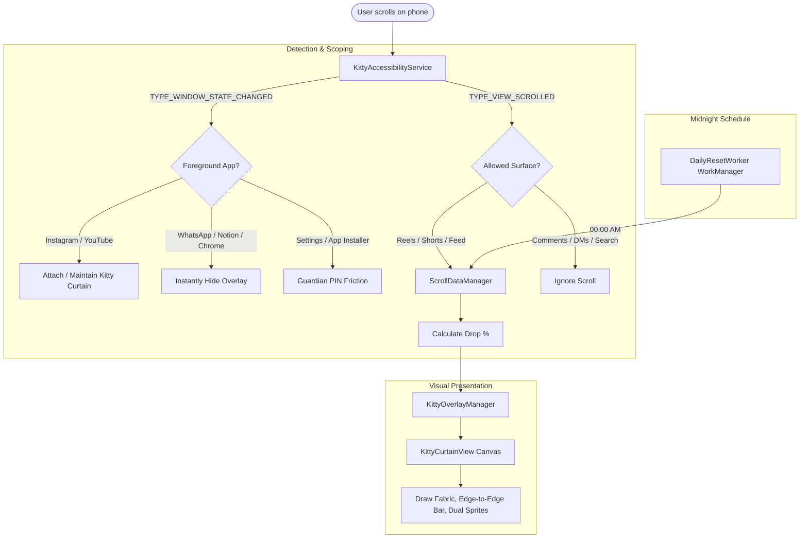

# 🐱 ClawBack: Kitty Curtain (AntiScroller)

ClawBack is an anti-doomscrolling Android application that gradually drops an adorable kitten and fabric curtain from the ceiling of the screen the more you scroll on **Instagram Reels** or **YouTube Shorts**.

Unlike brute-force app lockers that brick your entire phone or trap you into deleting the software, **ClawBack** scopes its overlay strictly to doomscroll video feeds.
WhatsApp, Notion, Chrome, Phone, and all productive apps remain 100% accessible and completely unrestricted.

> [!NOTE]
> For the complete visual design system, canvas mathematics, sprite animation physics, and token hierarchy, see [UI_DESIGN_SPEC.md](file:///e:/CODES/anti%20scroller/UI_DESIGN_SPEC.md).

---

## 🌟 Key Features

1. **Dual-Sprite Animated Kitty Curtain (`KittyCurtainView.kt`)**:
   - Cute pixel-art paws grip a full-width horizontal wooden bar extending across the screen.
   - Dual-sprite animation separates the cat body from the tail.
   - The tail wags energetically behind the body without cutting off legs or paws.
   - The cat body sways like a gentle pendulum as the curtain descends.
   - **Silent Scrolling**: Zero popups, zero chat bubbles, and zero speech distractions while scrolling.
   - **Full Lockout (100%)**: Once the daily scroll limit is reached, the curtain drops completely, touch input on reels is blocked, and the kitty curls up into a sleeping loaf with floating animated `Z z z` letters.

2. **Strict Addictive Surface Scoping (`KittyAccessibilityService.kt`)**:
   - The curtain only pulls down on 3 specific addictive surfaces:
     - Instagram Home Feed (downward scrolls).
     - Instagram Reels (forward video swipes).
     - YouTube Shorts (forward video swipes).
   - Comments, Direct Messages, user profiles, search explore grids, and standard YouTube watch players are completely ignored.
   - The curtain stays smoothly attached when switching tabs inside Instagram or YouTube, but hides immediately when opening other apps.

3. **Guardian / Partner PIN Guard (`GuardianUnlockActivity.kt`)**:
   - Lock down scroll cap settings and uninstallation with a security PIN known only to a parent or accountability partner.
   - Unlocks a 5-minute temporary maintenance window when the correct PIN is provided.

4. **Multiple Kitty Breeds**:
   - **Ginger Tabby**: Classic orange fur with cream scalloped curtain.
   - **Midnight Black Cat**: Dark fur with luminous golden eyes and slate midnight fabric.

5. **Daily Midnight Reset (`DailyResetWorker.kt`)**:
   - At `00:00` midnight every day, Android WorkManager resets today's scroll count back to `0`.
   - The kitty climbs back up to the ceiling for a fresh day.

6. **Smart Anti-Uninstall Friction (`KittyAdminReceiver.kt`)**:
   - Device Admin API and Accessibility Guard prevent impulsive uninstallation during doomscroll sessions.

---

## 🏗️ Architecture Overview



---

## 📂 Project Structure

```
anti scroller/
├── UI_DESIGN_SPEC.md                            # Comprehensive UI & visual design specification
├── MONETIZATION_PLAN.md                         # Business & monetization strategy
├── PLAY_STORE_LISTING.md                        # Google Play store copy & metadata
├── PRIVACY_POLICY.md                            # Complete privacy policy
├── app/
│   ├── build.gradle.kts
│   ├── proguard-rules.pro
│   └── src/main/
│       ├── AndroidManifest.xml
│       ├── java/com/antiscroller/kitty/
│       │   ├── MainActivity.kt                  # Material 3 Dashboard & Setup
│       │   ├── data/
│       │   │   └── ScrollDataManager.kt         # Daily tracking & midnight reset logic
│       │   ├── service/
│       │   │   └── KittyAccessibilityService.kt # Real-time scroll & app detection
│       │   ├── overlay/
│       │   │   └── KittyOverlayManager.kt       # System WindowManager overlay
│       │   ├── ui/
│       │   │   ├── KittyCurtainView.kt          # Custom Canvas dual-sprite kitty view
│       │   │   └── GuardianUnlockActivity.kt    # PIN modal dialog activity
│       │   ├── admin/
│       │   │   └── KittyAdminReceiver.kt        # Anti-uninstall friction guard
│       │   ├── receiver/
│       │   │   └── BootReceiver.kt              # Reboot handler for daily scheduler
│       │   └── worker/
│       │       └── DailyResetWorker.kt          # Midnight WorkManager reset
│       └── res/
│           ├── layout/
│           │   ├── activity_main.xml            # Dashboard layout
│           │   └── activity_guardian_unlock.xml # PIN unlock modal layout
│           ├── drawable/
│           │   └── ic_kitty_launcher.xml        # Vector adaptive launcher icon
│           ├── drawable-nodpi/
│           │   ├── kitty_black_body.png         # Midnight black cat body sprite
│           │   ├── kitty_black_tail.png         # Midnight black cat tail sprite
│           │   ├── kitty_orange_body.png        # Ginger tabby cat body sprite
│           │   └── kitty_orange_tail.png        # Ginger tabby cat tail sprite
│           ├── xml/accessibility_service_config.xml
│           ├── xml/device_admin_sample.xml
│           └── values/{colors, strings, themes}.xml
├── simulation/
│   └── index.html                               # Standalone Interactive Web Simulator
├── build.gradle.kts
├── settings.gradle.kts
└── gradle.properties
```

---

## 🚀 How to Run & Build

### 1. Interactive Browser Prototype
You can test the mechanics, scrolling physics, and kitty animation immediately in any browser:
- Open [`simulation/index.html`](file:///e:/CODES/anti%20scroller/simulation/index.html) in your browser.
- Use mouse wheel or click **Swipe to Next Video** to watch the kitty drop down.
- Switch between **Instagram Reels**, **Notes / WhatsApp**, and **Settings** to see the scoping in action.

### 2. Android Studio / Device Build
1. Open **Android Studio** and select **Open Project** -> select folder `e:\CODES\anti scroller`.
2. Connect your Android phone (or start an Android Virtual Device running Android 8.0 Oreo or higher, API 26+).
3. Click **Run 'app'** (`Shift + F10`).
4. On first launch, grant the three simple permissions via the dashboard cards:
   - **Accessibility Service**: Turn ON for *ClawBack*.
   - **Display Over Other Apps**: Grant overlay permission.
   - **Smart Anti-Uninstall**: Tap *Activate* to enable Device Admin protection.
5. Open Instagram or YouTube Shorts and start scrolling!
