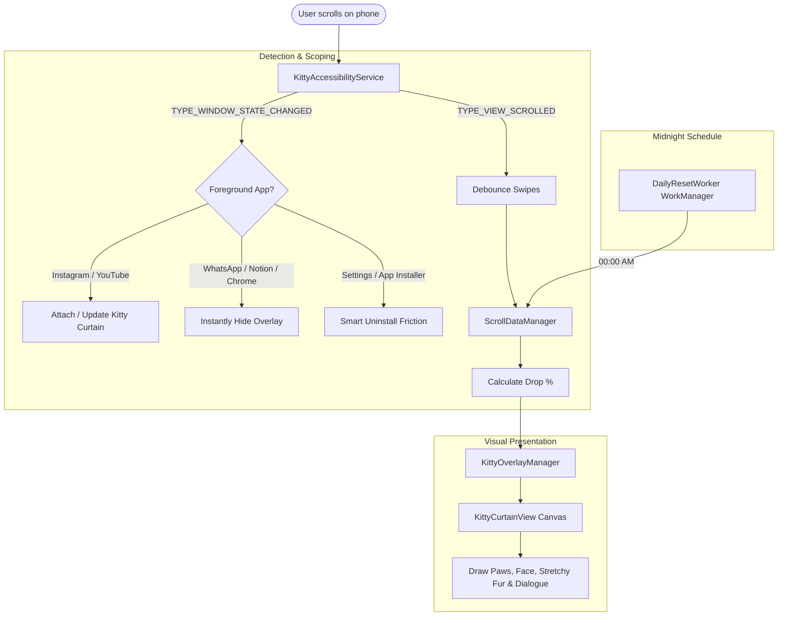

# 🐱 AntiScroller: Kitty Curtain

An anti-doomscrolling Android application that gradually drops an adorable kitten from the top of the screen the more you scroll on **Instagram Reels** or **YouTube Shorts**. 

Unlike brute-force app lockers that brick your entire phone or trap you into deleting the software, **AntiScroller** scopes its overlay strictly to doomscroll apps—leaving **WhatsApp, Notion, Chrome, Phone, and all productive apps 100% accessible and unrestricted**.

---

## 🌟 Key Features

1. **Stretchy Kitty Curtain (`KittyCurtainView.kt`)**:
   - Cute paws grip the top status bar / ceiling of your phone.
   - Every scroll on Instagram Reels or YouTube Shorts stretches the kitten's elastic torso further down.
   - Dynamic speech bubbles appear with witty remarks as screen coverage grows:
     - `10%`: *"Peek-a-boo! Scrolling already? 🐾"*
     - `35%`: *"Sliding down... maybe read a book? 📖"*
     - `65%`: *"Half the screen is Kitty now! 😼"*
     - `85%`: *"Heavy doomscrolling detected! Purr-ceed with caution! ⚠️"*
     - `100%`: 🛑 **Full Lockout**: A giant sleeping loaf cat covers the screen (`Zzz`) and blocks touch input on Reels/Shorts until midnight!

2. **Scoped Focus (Zero Restriction on Productive Apps)**:
   - The overlay **only** renders when you are inside Instagram or YouTube.
   - The moment you switch to WhatsApp, Google Docs, Slack, or any study app, the Kitty Curtain vanishes completely.

3. **Daily Midnight Reset (`DailyResetWorker.kt`)**:
   - At `00:00` midnight every day, Android WorkManager resets today's scroll count back to `0`, climbing the kitty back up to the ceiling.

4. **Smart Anti-Uninstall Friction (`KittyAdminReceiver.kt`)**:
   - Device Admin API and Accessibility Guard prevent impulsive uninstallation in the heat of a doomscroll binge.
   - Reminds you that your entire phone is still fully usable, breaking the dopamine urge to delete the tool.

---

## 🏗️ Architecture Overview



---

## 📂 Project Structure

```
anti scroller/
├── app/
│   ├── build.gradle.kts
│   ├── proguard-rules.pro
│   └── src/main/
│       ├── AndroidManifest.xml
│       ├── java/com/antiscroller/kitty/
│       │   ├── MainActivity.kt                  # Material 3 Dashboard & Setup
│       │   ├── data/
│       │   │   └── ScrollDataManager.kt         # Daily tracking & midnight reset logic
│       │   ├── service/
│       │   │   └── KittyAccessibilityService.kt # Real-time scroll & app detection
│       │   ├── overlay/
│       │   │   └── KittyOverlayManager.kt       # System WindowManager overlay
│       │   ├── ui/
│       │   │   └── KittyCurtainView.kt          # Custom Canvas cartoon kitty view
│       │   ├── admin/
│       │   │   └── KittyAdminReceiver.kt        # Anti-uninstall friction guard
│       │   ├── receiver/
│       │   │   └── BootReceiver.kt              # Reboot handler for daily scheduler
│       │   └── worker/
│       │       └── DailyResetWorker.kt          # Midnight WorkManager reset
│       └── res/
│           ├── layout/activity_main.xml
│           ├── drawable/ic_kitty_launcher.xml
│           ├── xml/accessibility_service_config.xml
│           ├── xml/device_admin_sample.xml
│           └── values/{colors, strings, themes}.xml
├── simulation/
│   └── index.html                               # Standalone Interactive Web Simulator
├── build.gradle.kts
├── settings.gradle.kts
└── gradle.properties
```

---

## 🚀 How to Run & Build

### 1. Interactive Browser Prototype
You can test the exact mechanics, scrolling physics, and kitty animation immediately in any browser:
- Open [`simulation/index.html`](file:///e:/CODES/anti%20scroller/simulation/index.html) in your browser.
- Use mouse wheel or click **Swipe to Next Video** to watch the kitty drop down.
- Switch between **Instagram Reels**, **Notes / WhatsApp**, and **Settings** to see the smart scoping in action!

### 2. Android Studio / Device Build
1. Open **Android Studio** and select **Open Project** -> select folder `e:\CODES\anti scroller`.
2. Connect your Android phone (or start an Android Virtual Device running Android 8.0 Oreo or higher, API 26+).
3. Click **Run 'app'** (`Shift + F10`).
4. On first launch, grant the three simple permissions via the dashboard cards:
   - **Accessibility Service**: Turn ON for *AntiScroller Kitty*.
   - **Display Over Other Apps**: Grant overlay permission.
   - **Smart Anti-Uninstall**: Tap *Activate* to enable Device Admin protection.
5. Open Instagram or YouTube Shorts and start scrolling!
